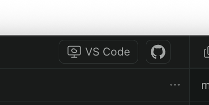

# Paseo VS Code Tunnel

Open your current Paseo workspace or worktree in VS Code through an automatically detected remote tunnel, with a fallback to vscode.dev.

The plugin adds a **VS Code** button to Paseo. It resolves the workspace’s directory on the host, detects the connected tunnel, and opens that directory on the device you are using.



## Features

- Open the exact workspace or Git worktree directory.
- Detect the active tunnel with `code tunnel status`; no tunnel name to configure.
- Open desktop VS Code in a new window, with a browser fallback to vscode.dev.
- Access the button from the workspace header on desktop and mobile.
- Handle spaces, Unicode, and reserved characters in directory paths.

The plugin uses an existing tunnel. It does not start, configure, or modify tunnels. One tunnel serves the host; you do not need a separate tunnel for each worktree.

## Requirements

On the machine running the Paseo daemon:

- Paseo **0.12.0 or later**, with plugins enabled.
- The VS Code CLI (`code`) available in the daemon’s `PATH`.
- A connected VS Code tunnel, for example one started with:

  ```sh
  code tunnel --name my-tunnel
  ```

On the device opening the workspace:

- For desktop access: VS Code with the **Remote - Tunnels** extension (`ms-vscode.remote-server`), signed in with the same GitHub or Microsoft account as the tunnel.
- For browser access: sign in to vscode.dev with the same account as the tunnel.
- Allow the browser to open `vscode://` links when prompted to launch the desktop app.

## Installation

On the Paseo host, install directly from GitHub:

```sh
paseo plugin install https://github.com/yboyer/paseo-vscode-tunnel
```

Alternatively, install from a local clone by running this command from the repository root:

```sh
paseo plugin install "$PWD"
```

No `npm ci` step is needed to install this plugin: Paseo provides its runtime dependencies. Install the development dependencies only if you want to run the checks described in [Development](#development).

In Paseo, enable plugins under **Settings → Plugins** for the target daemon.

## Usage

1. Open a workspace in Paseo.
2. Click **VS Code** in the workspace header on desktop, Android, iOS, or a mobile browser.
3. Allow VS Code to launch, or continue in vscode.dev if the browser fallback opens.

The link opens on the device where you click the button. To open desktop VS Code on your computer, use Paseo on that computer.

For a tunnel named `my-tunnel` and a workspace at `/path/to/my-project`, the plugin generates:

```text
vscode://vscode-remote/tunnel+my-tunnel/path/to/my-project?windowId=_blank
```

Its browser fallback is:

```text
https://vscode.dev/tunnel/my-tunnel/path/to/my-project
```

Git worktrees open at their own absolute paths.

## Browser fallback

In the native Paseo mobile app, the plugin checks whether the device can handle `vscode://` links. If no handler is available or opening the link fails, it opens the HTTPS URL instead.

In the Paseo web UI, the plugin tries `vscode://` first. If the page remains active, it opens vscode.dev after 2.5 seconds. Losing focus, hiding the page, or navigating away cancels the fallback.

Browsers cannot reliably report whether an external app launched. A confirmation dialog may cancel the fallback even if VS Code never opens; a launch that leaves the page focused may also open vscode.dev. The plugin cannot detect a tunnel connection failure after VS Code launches.

## Troubleshooting

| Problem                              | What to check                                                                              |
| ------------------------------------ | ------------------------------------------------------------------------------------------ |
| The **VS Code** button is missing    | Enable plugins on the correct daemon and look in the workspace header.                     |
| The `code` command cannot be found   | Ensure it is available in the Paseo daemon’s `PATH`.                                       |
| No connected tunnel is detected      | Run `code tunnel status` on the Paseo host and start or reconnect the tunnel.              |
| VS Code or vscode.dev cannot connect | Check that the tunnel is still connected and that you are signed in with the same account. |
| The desktop app does not open        | Allow `vscode://` links and ensure VS Code and Remote - Tunnels are installed.             |

## Development

Install dependencies and run the checks:

```sh
npm ci
npm run lint
npm test
```

After making changes, reload the installed plugin:

```sh
paseo plugin reload paseo-vscode-tunnel
```
